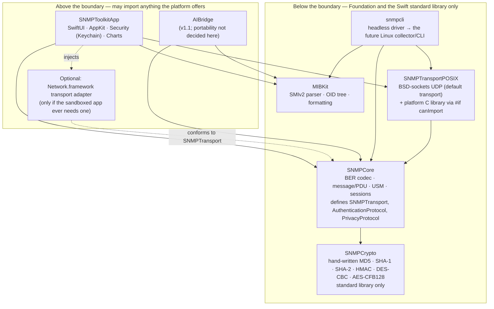

# ADR-SNMP-01 — The protocol engine is a Foundation-only portable core

| | |
|---|---|
| **Status** | proposed — awaiting review; becomes *accepted* when the pull request carrying it merges |
| **Date** | 2026-10-14 |
| **Decides** | whether `SNMPCore` commits to a portability boundary, and where that boundary runs |
| **Decision** | **Option C — Foundation-only portable core.** No Apple-only API below the boundary. |
| **Supersedes** | nothing; first record in this log |
| **Governs** | `Package.swift`, `Sources/SNMPCore`, `Sources/MIBKit`, `Sources/snmpcli`, and every target later added beneath the boundary |

---

## 1. Context — the forces in tension

The repository disagreed with itself about whether this product has a portable core, and every module boundary the architecture work still has to draw depends on the answer.

- **The backlog said portable.** An epic titled *Portable shared engine*, labelled as belonging to a product *family*, implied more than one product built on the same engine.
- **The specification said macOS-native.** `docs/specification.md` §3 listed *Cross-platform (iOS, Windows, Linux)* as an explicit non-goal: "The app is macOS-native throughout; portability would cost that."
- **The README went further.** The declared stack was "Network.framework · CryptoKit/CommonCrypto", under constraint **C-2**: no third-party runtime dependencies. `Network.framework` and `CommonCrypto` are Apple-platform APIs. A core built directly on them is portable to iOS at best and to nothing else — and C-2 forbids reaching for a cross-platform library to close the gap.

These could not all be true at once, and the difference is not a documentation tidy-up. It decides whether the engine's transport and cryptography sit behind protocol boundaries with platform implementations injected, or call the platform directly — a different codebase, not a different comment.

The forces:

| Force | Pulls toward |
|---|---|
| **C-2** — no third-party runtime dependencies | Apple frameworks (cheapest) *or* hand-written code (portable). Nothing in between. |
| **C-1 / C-3** — Swift 6, macOS 14+, App Sandbox | Platform APIs are available and already vetted by Apple. |
| **INV-4, NFR-8** — hostile input never crashes; auth failure never returns a partial result | Whatever the crypto path is, it is security-critical and must be reviewable. |
| **NFR-9** — the suite runs with no network | A transport seam is needed anyway, to substitute a fake. |
| **Second product** — a headless Linux/server-side collector or CLI | Only a Foundation-only core can be reused there. |
| **Cost** — v1.0 is one person's product on a timebox | Every hand-written primitive is engineering, review and test-vector work that the platform would have given away. |

The one input engineering did not hold was whether a second product exists. That is a product-owner answer.

## 2. The product-owner answer, verbatim

Recorded **2026-10-14**:

> "Option C — Foundation-only portable core. The second product that justifies this cost is a Linux/server-side agent or CLI (a headless collector/CLI)."

This is the answer to the spike's gating question — *is there a second product?* — and it is **yes**, named: a headless Linux/server-side collector or CLI sharing `SNMPCore`. Nothing in this record may be read as having chosen Option C on engineering preference; the cost is justified by that product and by nothing else (see §7).

## 3. Decision

**`SNMPCore` is a Foundation-only portable core.** Below the boundary, nothing imports an Apple-only framework. Transport and cryptography sit behind protocols defined in the core, with default implementations that are themselves portable: a BSD-sockets UDP transport, and hand-written Swift implementations of every USM cryptographic primitive.

### 3.1 Where the boundary runs



Target names below the boundary other than the three that already exist (`SNMPCore`, `MIBKit`, `snmpcli`) are **proposals** for the architecture work that follows; the rule in §3.2 binds whatever they end up being called.

### 3.2 The import rule — checkable by reading an import list

A reviewer applies this rule to the `import` statements of a target and nothing else. If a question remains after reading the imports, the rule has failed and must be tightened here, by a superseding record.

| Target (or any future target in the same position) | May import | May **not** import |
|---|---|---|
| `SNMPCrypto` (proposed) | the Swift standard library **only** — not even `Foundation` | everything else |
| `SNMPCore` | `Foundation`, `SNMPCrypto` | `Network`, `CryptoKit`, `CommonCrypto`, `Security`, `AppKit`, `SwiftUI`, `Combine`, `os`, `Darwin`, any `*Kit`, any other Apple-only framework |
| `MIBKit` | `Foundation` | as above |
| `SNMPTransportPOSIX` (proposed) | `Foundation`, `SNMPCore`, and **exactly one** platform C library selected with `#if canImport(Darwin) / Glibc / Musl` | `Network`, `CryptoKit`, `CommonCrypto`, `Security`, `AppKit`, `SwiftUI`, `Combine`, `os`, any `*Kit`, any other Apple-only framework, and any platform C library **other than** the single `#if canImport` branch actually selected |
| `snmpcli` | anything the rows above may import, plus `SNMPCore`, `MIBKit`, `SNMPTransportPOSIX` | every Apple-only framework — this target is the seed of the second product |
| `SNMPToolkitApp`, `AIBridge`, any UI or platform adapter | anything the platform offers | — |
| Test targets for the targets below the boundary | `XCTest`/`Testing`, the target under test, and Apple frameworks **only as test oracles**, guarded by `#if canImport(...)` so the tests also compile on Linux | — |

Three clarifications, so the table is not argued around:

1. **`Foundation` means the portable subset.** On Linux, `Foundation` is `swift-foundation` (`FoundationEssentials` and `FoundationInternationalization`); `URLSession` and friends live in `FoundationNetworking`. Nothing below the boundary needs `FoundationNetworking`, and importing it below the boundary is a defect.
2. **`Darwin` is an Apple-only module and is forbidden to `SNMPCore`.** The platform C library enters the portable set in exactly one place — the POSIX transport — and only behind `#if canImport`. Anything else that needs a C-library call (a monotonic clock, say) goes through `Foundation` or `Dispatch`, both of which exist on Linux.
3. **The Keychain is above the boundary.** INV-1's non-encodable credential type lives in `SNMPCore` and is pure Swift; *storing* a credential in the macOS Keychain is an adapter in the app that conforms to a credential-store protocol the core defines. `Security.framework` never appears below the line.

**The mechanical check** a reviewer or CI step runs, **one invocation per target**, each with *that target's own* allow-list from the table above — not one shared scan. A combined scan across all targets with one merged allow-list cannot catch a target importing a *sibling* module the table forbids it (e.g. `MIBKit` importing `SNMPCore`, which the table does not permit, or `SNMPCore` importing `SNMPTransportPOSIX`, which would reverse the dependency direction §3.1's diagram draws): the merged list would accept either import as "some target's" allowed name, even inside the wrong target. Each check below extracts just the imported module's name — not the whole line — so a trailing comment (`import Foundation // why`) cannot produce a false positive, and must print nothing:

```sh
check() { # <dir> <allowed module names...>
  local dir="$1"; shift
  grep -rhE '^[[:space:]]*(@[A-Za-z_]+[[:space:]]*)*(public|package|internal|private|fileprivate)?[[:space:]]*import[[:space:]]' "$dir" 2>/dev/null \
    | sed -E 's/.*[^[:alnum:]_]import[[:space:]]+//; s/^import[[:space:]]+//' \
    | sed -E 's/^(class|struct|enum|protocol|typealias|func|var|let)[[:space:]]+//' \
    | sed -E 's/^([A-Za-z0-9_]+).*/\1/' \
    | sort -u \
    | grep -vxF -f <(printf '%s\n' "$@")
}
check Sources/SNMPCore Foundation SNMPCrypto
check Sources/MIBKit   Foundation
check Sources/snmpcli  Foundation SNMPCore MIBKit SNMPTransportPOSIX
```

The detection half anchors to the start of the line (after whitespace) but allows an optional Swift 6 access-level modifier (`public import Foundation`, `internal import Network`, per SE-0409) or attribute (`@_implementationOnly import CryptoKit`) before the literal `import` — so a modified import is still caught, while a comment that merely mentions the word "import" mid-sentence is not mistaken for one, since it doesn't start the line with an attribute, access modifier or `import` itself. The extraction half strips an optional submodule-import kind keyword (`import class Foundation.NSObject`) before taking the module name, so that case doesn't get misread as importing a module named `class`.

On the day of this record every one of these three prints nothing: `SNMPCore` and `MIBKit` import only `Foundation`, and `snmpcli` imports only `Foundation` and `SNMPCore`/`MIBKit` — each within its own row's allowance, not merely within the union of all rows. **The boundary is already clean; this record keeps it so.**

This design is scoped to **today's three existing targets** but, unlike a single shared-allow-list scan, it **does** generalize: when `SNMPCrypto` and `SNMPTransportPOSIX` materialise as their own targets (§8 item 3), add one `check` line per new target with its own allow-list from the table — `check Sources/SNMPCrypto` (no arguments: the standard library only, so *nothing* above it is allowed) and `check Sources/SNMPTransportPOSIX Foundation SNMPCore` (the single selected platform C library needs its own carve-out, since `#if canImport(Darwin|Glibc|Musl)` conditional imports aren't ordinary `import` statements this check scans for — a future record settles exactly how that's verified). A future architecture record's CI lane turns this into an enforced gate rather than a command a reviewer has to remember to run.

**The real test** is a Linux build. The architecture work adds a CI lane that builds the targets below the boundary on an Ubuntu runner using the official `swift` container image (an image, not a third-party action — consistent with how the existing workflow reads C-2). Until that lane exists, the `grep` above is the gate and the Linux build is an **unverified claim**: the throwaway proof made for this decision compiled on macOS only, because this machine had no Linux Swift toolchain.

## 4. The cryptographic primitives this decision obliges us to write

Under C-2, with no Apple framework below the boundary, every primitive USM needs is hand-written Swift. The inventory below is derived from `docs/specification.md` §5 (protocol conformance scope), not from the spike's shorthand list, and it is longer than that list.

| # | Primitive | Needed by | Specification / test vectors |
|---|---|---|---|
| 1 | **MD5** | HMAC-MD5-96 (RFC 3414) and its key localisation | RFC 1321, with the §A.5 test suite |
| 2 | **SHA-1** | HMAC-SHA-96 (RFC 3414) and its key localisation | FIPS 180-4; RFC 3174 vectors |
| 3 | **SHA-224, SHA-256, SHA-384, SHA-512** | HMAC-SHA-2 (RFC 7860) and their key localisation | FIPS 180-4; NIST CAVP vectors |
| 4 | **HMAC** (the construction, generic over 1–3) | all authentication protocols; truncation to 96/128/192/256/384 bits per RFC 3414 §6 and RFC 7860 §4 | RFC 2104; RFC 2202 (MD5/SHA-1) and RFC 4231 (SHA-2) vectors |
| 5 | **USM key localisation** | password → `Ku` (1 MiB hash expansion) → `Kul` (hash over `Ku ‖ engineID ‖ Ku`) | RFC 3414 §A.2, with the §A.3 vectors for MD5 and SHA-1; RFC 7860 §9 for SHA-2 |
| 6 | **DES** block cipher, **encrypt and decrypt**, and **CBC** mode | CBC-DES privacy (RFC 3414 §8); the 16-octet privacy key splits into an 8-octet DES key and an 8-octet pre-IV, the IV being pre-IV XOR salt | FIPS 46-3; NIST DES known-answer tests |
| 7 | **AES-128** block cipher (encrypt direction only — CFB decrypts with the forward cipher) and **CFB-128** mode | CFB128-AES-128 privacy (RFC 3826) | FIPS 197; NIST SP 800-38A §F.3 CFB128 vectors |
| 8 | **AES-192 and AES-256** key schedules, plus the **privacy-key extension** that stretches a localised key to 24 or 32 octets | the non-standard AES-192/256 the spec implements for vendor interop and labels *non-standard* in the UI | Blumenthal–Maino–McCloghrie draft §3.1.2.1 — **two incompatible extension algorithms exist in the wild** (the draft's own, and the Reeder variant); which one(s) to implement is an open item in §8 |
| 9 | **Constant-time comparison** of the received and computed authentication parameters | INV-4: a forged or corrupted `msgAuthenticationParameters` must fail without leaking timing | — |

**Not needed, and deliberately not written:** 3DES-EDE (the Reeder draft; not in §5), any hash outside MD5/SHA-1/SHA-2, any public-key primitive, and a CSPRNG — the Swift standard library's `SystemRandomNumberGenerator` is portable and is used for `msgID`, `request-id` and the initial salt. The privacy salt itself is a non-repeating counter seeded from `snmpEngineBoots`, per RFC 3414 §8.1.1.1 and RFC 3826 §3.1.2.1, not a random value.

### 4.1 Review requirement — an open item, not a decision

**Hand-rolled crypto with no named reviewer is not a decision, it is a hazard.** Therefore:

- **No hand-written implementation of any primitive in the table above merges until a named reviewer, competent in cryptographic implementation, has reviewed it.** The reviewer is named per primitive family (hashes and HMAC; DES-CBC; AES-CFB and key extension) in the pull request that carries the code, and in a follow-up record to this one.
- **This record does not name the reviewer.** Assigning one is a product-owner and security-reviewer decision that had not been taken when this record was written. It is listed in §8 as the first open item, and the USM stories are blocked on it: they cannot reach *in review* until the name exists.
- Review alone is not sufficient. Every primitive ships with **known-answer tests** against the vectors cited in the table, and — on macOS, in test targets only, per §3.2 — **differential tests** against a platform oracle over random inputs: `CryptoKit` for the hashes, HMAC and key localisation (rows 1–5), `CommonCrypto` for DES-CBC and AES-CFB128 (rows 6–7, neither of which `CryptoKit` implements — see §5's rejection of Option A), and nothing platform-provided for the AES key-extension algorithm or constant-time comparison (rows 8–9, which have no oracle and rely on known-answer tests and review alone). A primitive with a reviewer but no vectors, or vectors but no reviewer, does not merge.
- **Timing side channels are an accepted residual risk**, stated here so they are not discovered later: a table-driven AES or DES in Swift is not constant-time against cache attacks. The threat model is a manager on a LAN talking to devices it configured; the mitigation is the constant-time comparison in row 9 and nothing more. The reviewer confirms or rejects this acceptance.

## 5. Options rejected

### Option A — macOS-native throughout (rejected)

`SNMPCore` calls `Network.framework` and `CryptoKit`/`CommonCrypto` directly. Cheapest; matches §3 and the README as they stood; the *Portable shared engine* epic becomes NO GO.

**Why it lost:** it forecloses the second product the product owner has now named. A core that imports `Network` cannot be built on Linux at all, and C-2 means there is no library to swap in later — the only reversal path from A is a rewrite of transport and USM. It also gives less than it appears to: `CryptoKit` has no DES and no AES-CFB, so even Option A reaches down to the C-level `CommonCrypto` (`CCCryptorCreateWithMode`) for both privacy ciphers.

### Option B — Apple-platform portable (rejected)

Transport and crypto sit behind protocols; the shipped implementations are Apple's; an iOS or CLI target can reuse the engine on Apple platforms.

**Why it lost:** it buys the boundary without the product. The named second product is a *Linux/server-side* collector; B gets the engine to iOS, which nobody asked for, and still cannot build on Linux because the only implementations behind the protocols are Apple's. B is nevertheless the **fallback shape** this decision degrades to if the Linux product never materialises (see §7): the protocols stay, the hand-written implementations are replaced by `CryptoKit`/`CommonCrypto` adapters. That is why the protocols in §3 are designed first and the implementations second.

Both options were genuinely viable. Neither lost on preference; each lost on a force in §1 — A on *second product*, B on *second product* and *C-2* together.

## 6. Consequences

**What becomes possible**

- A headless Linux/server-side collector or CLI can share `SNMPCore`, `MIBKit` and the POSIX transport unchanged. `snmpcli` is already shaped as its seed.
- The *Portable shared engine* epic is **reopened**, not NO-GOed: a second product now exists by name. Its scope is the engine the Linux product will consume, and this record is its first decision.
- NFR-9's no-network suite gets its transport seam for free; the fake transport is just another `SNMPTransport`.

**What it costs — accepted knowingly**

- **Nine cryptographic primitives written, vector-tested, differentially tested and reviewed** (§4), where Options A and B would have had the *ciphers* for seven of them from the platform (rows 1–7). Row 8's privacy-key extension is not a platform primitive under any option — it is SNMP-specific key-stretching from the Blumenthal–Maino–McCloghrie draft, not something `CryptoKit`/`CommonCrypto` implements — so it is hand-written either way, alongside row 9's constant-time comparison. Only seven of the nine are actually bought back by reversing to B, not eight. This is the single largest cost of the decision.
- **A review dependency outside the team:** the USM stories are blocked until a reviewer is named (§4.1, §8).
- **A second CI lane** (Linux build) to keep the boundary honest, and the maintenance of two platform C-library branches in the POSIX transport.
- **Export-compliance exposure may change.** An app whose encryption comes only from the OS can usually rely on the platform's classification; an app shipping its own cipher implementations may need its own self-classification. Whether this applies, and to which distribution channel, is for the distribution work to establish — flagged here so it is not found at submission time.
- **Performance ceiling:** hand-written Swift AES without hardware intrinsics is slower than `CryptoKit`. SNMP payloads are small (bounded by `msgMaxSize`), so this is not expected to matter against NFR-1; it is measured, not assumed.

**What changes in the artefacts**

- `docs/specification.md` §3's cross-platform non-goal is narrowed in the same change as this record: cross-platform *applications* remain a non-goal and the v1.0 shippable product remains the macOS app alone, while the engine beneath it is kept Apple-free for the named future direction. A new constraint, **C-12**, carries the import rule into the specification so the specification and this record cannot drift apart.
- The README's stack line no longer names `Network.framework` or `CryptoKit/CommonCrypto` as the engine's foundation.

**What it does *not* decide** (left to the architecture records that follow this one): the concurrency model inside the core, the persistence format, the error taxonomy beyond the three cases that exist today, the UI/engine boundary, the exact API of `SNMPTransport` and the crypto protocols, and whether `AIBridge` sits above or below the boundary.

## 7. Reversal cost and reopening triggers

**If the Linux/server-side collector or CLI never materialises**, Option C's cost was spent for nothing except the testing seam. The reversal path is to **degrade to Option B**: keep the protocols, replace `SNMPCrypto`'s implementations with `CryptoKit`/`CommonCrypto` adapters, and stop building the Linux lane. What is sunk at that point is the hand-written crypto, its vectors and its review; what is kept is the boundary, which still pays for itself in NFR-9. The reversal is cheap precisely because this record puts the protocols first.

This record is **reopened** — by a superseding record, never by editing this one — when any of the following is observed:

1. **The second product does not start.** No backlog item for the Linux/server-side collector or CLI is in an executable status by the time v1.0 of the macOS app ships. Then the justification in §2 has lapsed and the degrade-to-B path is evaluated.
2. **No crypto reviewer can be named** before the first USM story needs to merge. The decision is then blocked on its own precondition and must either find the reviewer or degrade to B for the blocked primitives.
3. **The Linux build cannot be made to pass** for a reason rooted in `swift-foundation` or the toolchain rather than in our code — the premise that `Foundation` is the portable floor would be false.
4. **The import check or the Linux lane is red on `main` for more than one sprint.** A boundary nobody keeps is not a boundary; either it is repaired or the record is superseded.

A review date is deliberately absent. The triggers are observations, and the first of them has a natural clock: v1.0 shipping.

## 8. Open items

Recorded here so they are not mistaken for decided:

1. **Name the cryptographic reviewer(s)** — a product-owner / security-reviewer assignment. Blocks every USM implementation story. Not invented in this record.
2. **AES-192/256 key extension:** implement the draft's own algorithm, the Reeder variant, or both behind a per-target setting — decided on interop evidence from the three agents named in SC-3.
3. **Target naming** (`SNMPCrypto`, `SNMPTransportPOSIX`) and whether the crypto module is a separate target or a folder inside `SNMPCore` — a separate target makes the "standard library only" rule checkable with an analogous per-target `grep` (§3.2), which is why it is proposed.
4. **Whether the sandboxed macOS app uses the POSIX transport or a `Network.framework` adapter.** TN3179 applies the local-network consent gate to both; BSD sockets work under App Sandbox with the C-7 entitlements. Default: POSIX everywhere unless the signed, sandboxed build shows a reason.
5. **Export-compliance classification** of an app shipping its own cipher implementations — distribution work.
6. **`AIBridge` portability** — v1.1; above or below the boundary is undecided and does not affect v1.0.

---

*Format note.* Records in this log carry: status, date, context as forces, the decision, the alternatives that lost with the force each lost on, consequences including accepted cost, and the observation that reopens the record. Accepted records are not edited; they are superseded.
