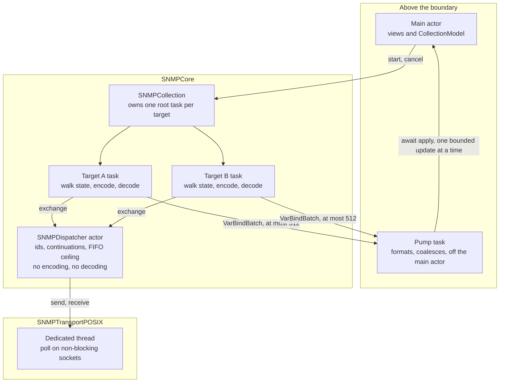

# ADR-SNMP-04 — Work runs in tasks, shared state lives in a few actors

| | |
|---|---|
| **Status** | Proposed — the product owner rules on it; becomes *accepted* when the pull request carrying it merges |
| **Date** | 2026-11-04 |
| **Decides** | actors or structured tasks inside the core; what is `Sendable` at each module boundary; how FR-5, FR-6 and NFR-3 are held by the design |
| **Decision** | **Each target's work is a task that owns its state. Actors hold only state shared between tasks, and do no work.** A target's task cannot throw, and it returns what it collected. The main actor receives only bounded updates, one at a time. |
| **Builds on** | [ADR-SNMP-01](ADR-SNMP-01-portability-boundary.md), whose import rule is what keeps blocking calls out of the core. Refines [ADR-SNMP-02](ADR-SNMP-02-transport.md) on two points of `SNMPDispatcher` (Decision 3). Uses the protocols of [ADR-SNMP-03](ADR-SNMP-03-crypto.md) unchanged |
| **Governs** | `Sources/SNMPCore`, `Sources/MIBKit`, `Sources/SNMPCrypto`, `Sources/SNMPTransportPOSIX`, `Sources/snmpcli`, and the crossing from those into `Sources/SNMPToolkitApp` |

---

## Background

Today the engine is a BER codec and an OID type, both plain value types, plus one actor, `StandardMIBBundle`. Nothing collects yet. Sessions, walks, USM and the MIB tree are about to be written, and under C-1 (Swift 6, strict concurrency) the choice made now is written into every signature they expose.

Three requirements drive the choice. FR-5: collect from many targets at once, and one target's failure must not affect another. FR-6: cancel promptly and keep what was collected. NFR-3: no main-actor work over 16 ms during collection, filtering or charting.

The trap in this choice is that an actor looks like isolation and is not. Swift's actors protect memory from data races. They do not isolate failures, they do not serialise a method across an `await`, and they do not make cancellation any less cooperative. So each property below names the type or boundary that holds it, and says so where nothing can.

All timings below come from a throwaway prototype of this design, not kept in this repository, on an 11-core Apple silicon Mac with Swift 6.3.3, compiled for a macOS 14 target in Swift 6 language mode with warnings as errors, against a fake transport. They show the shape of each effect and are not product benchmarks.



## Decision 1 — Tasks do the work; actors hold shared state and do no work

**Decision.** The core is written as `async` functions over value types, run by tasks. A new actor is justified only by mutable state that several tasks share and that outlives any one of them.

**What it means.** A walk's cursor, its rows and its retry position are local variables of one task. The actors are a short list:

| Actor | Shared state | Status |
|---|---|---|
| `SNMPDispatcher` | ids in flight, parked continuations, the ceiling's queue | ADR-02, refined below |
| `USMEngineState` | one engine's discovered ID, boots and time, shared by concurrent requests to it | proposed; the USM record decides it |
| `StandardMIBBundle` | the cache of bundled module text | exists |
| The compiled-MIB store | the current tree, replaced whole when a module is imported | proposed; MIBKit's own story names it |

**Consequences**

1. Walk state cannot be shared by accident: the compiler rejects a captured `var` mutated from two concurrent tasks.
2. Code in a task is sequential, so a walk never has to re-check its state after an `await`. In an actor it would have to: ten concurrent calls that read a counter, awaited, and wrote it back left the counter at 1, not 10.
3. Actors stay fast because nothing long runs in them. This is a rule a compiler cannot check: a blocking or expensive call inside an actor compiles without complaint and stalls every caller. In the prototype, a `poll` inside an actor kept another caller waiting 278 ms.
4. No blocking call can enter a task in the core through the C library, because ADR-01's import rule keeps `Darwin` and `Glibc` out of `SNMPCore` and `MIBKit`. Foundation's blocking calls are not covered by that rule, so the check in Decision 6 names them.
5. Blocking calls stay on the POSIX transport's dedicated thread, as ADR-02 has it. They must not reach the cooperative pool, which is exactly as wide as the core count: 44 blocking tasks on 11 cores ran in waves of 11.
6. State read from a synchronous path cannot be an actor, since a synchronous function cannot `await` one. `OutboundRequest.encode` is synchronous, so what it needs is either captured as an immutable snapshot before the exchange or held in a lock-guarded class on the closed list in Decision 2. The compiler helps here: `NSLock.lock()` and `unlock()` are unavailable in async code, leaving `withLock`, which cannot hold a lock across an `await`.

## Decision 2 — Only values cross a module boundary

**Decision.** Everything public that crosses a module boundary is a `Sendable` value type with `let` fields, or a type on the short list below. `sending` is not used in public signatures. `@unchecked Sendable` is limited to a closed list of named types.

**What it means.**

| Boundary | What crosses | Why it is `Sendable` |
|---|---|---|
| `SNMPCrypto` to `SNMPCore` | `[UInt8]`, the hash and cipher values, `CryptoError` | value types, no shared state (ADR-03) |
| `SNMPCore` to `AuthenticationProtocol` and `PrivacyProtocol` conformers | `LocalizedKey`, `PrivacyKey`, `[UInt8]`, `OID` | value types; the protocols refine `Sendable` |
| `SNMPCore` to `SNMPTransportPOSIX` | `SNMPTransport`, `SNMPAddress`, `InboundDatagram`, `SNMPTransportError` | value types; the conformer is on the closed list |
| `SNMPCore` to the app and `snmpcli` | `SNMPEngine`, `CollectionRequest`, `TargetID`, `VarBind`, `VarBindBatch`, `CollectionOutcome`, `SNMPError` | value types, checked by the compiler |
| `SNMPCore` to the app and `snmpcli` | `SNMPCollection`, `SNMPDispatcher` | a `final class` of `let`s, checked by the compiler; an actor |
| `MIBKit` to the app and `snmpcli` | `StandardMIBBundle`; the compiled tree as an immutable value; filter results as node indices | an actor; value types whose sharing costs no copy |
| The app's pump to the main actor | `BoundedUpdate` | value type, bounded when constructed (Decision 5) |

**Consequences**

1. The closed list of `@unchecked Sendable` types is the POSIX transport, `FakeTransport`, `TestClock` and `SaltSource`, all from ADR-02 and ADR-03. Adding one is a change to this record. The compiler does not check these four, so ADR-02's locking rule and the ThreadSanitizer lane carry them.
2. `nonisolated(unsafe)`, `assumeIsolated` and `@preconcurrency` are not used below the boundary.
3. A `~Copyable` credential cannot be captured by a `@Sendable` closure, which the compiler rejects. So `encode` captures the derived `LocalizedKey` and `PrivacyKey`, and the credential never travels with a request. This helps INV-1 and INV-2.
4. A non-`Sendable` type may still be used inside one task, such as a parser's working state. The compiler permits that and rejects any use after it has been handed to another isolation domain.
5. `MIBKit` cannot import `SNMPCore` (ADR-01), so turning a `VarBind` into a named, formatted row needs both modules and happens above them, in the pump.

**Why no `sending`.** It compiles and does avoid a copy, but it asks every caller to prove a region property, to save a copy that a value type of arrays does not make anyway.

## Decision 3 — The dispatcher holds state, and every request passes its ceiling

**Decision.** `exchange` runs on the calling target's task and enters the actor only to register an id, take a slot, or receive a response. All encoding, including v3 authentication and encryption, happens off the actor. The FR-5 ceiling counts requests in flight and is enforced inside `exchange`, first come first served.

```swift
public struct InFlightCeiling: Sendable, Hashable {
    public let value: Int
    /// Throws `SNMPError.invalidConfiguration` outside 1...512.
    public init(_ value: Int) throws
    public static let `default`: InFlightCeiling   // 16; see open item 1
}

public actor SNMPDispatcher {
    public init(transport: any SNMPTransport, clock: any Clock<Duration> = ContinuousClock(),
                ceiling: InFlightCeiling = .default)
    @concurrent public func exchange(_ request: OutboundRequest, to target: SNMPAddress,
                                     policy: RetryPolicy) async throws -> InboundResponse
    public func shutdown() async
}
```

**What it means.** This refines ADR-02 on two points: `exchange` becomes `@concurrent` where it was isolated to the actor, and `init` gains `ceiling`, with a default. Existing call sites still compile. Each request waits for a slot, holds it through all its attempts, and gives it back. The timeout clock starts only once a slot is held, so waiting in the queue does not use up retries. The reader decodes only the id, off the actor, and hands the response to the actor to complete the waiting request.

**Consequences**

1. One target's expensive encoding does not delay another's traffic. With a 50 ms `encode` on one target, a healthy target's worst round trip was 150 to 200 ms when encoding ran on the actor, and 0.1 ms when it ran on the caller's task.
2. The engine reaches the socket only through `exchange`, because the dispatcher's transport is private. So the ceiling holds without any call site remembering it, and it covers retries too.
3. A walk has at most one request outstanding, so it holds a slot only while waiting on the network. Targets interleave: six walks sharing two slots had collected 50 to 75 rows each when cancelled, with none starved.
4. The ceiling is capped at 512 so the engine's own traffic cannot fill ADR-02's inbound buffer of 1,024 datagrams on its own.
5. One serial actor is not a throughput limit here: 56,000 to 88,000 exchanges a second in the prototype, against about 107 a second for NFR-1's rate on eight targets. That figure excludes the network and real cryptography.
6. A task created inside an actor method that captures `self` inherits the actor's isolation, which the compiler showed on the prototype's reader. So the reader is a `nonisolated` function, started with an explicit `.userInitiated` priority, not with whatever priority the first caller happened to have.
7. A test holds the off-actor property, not the compiler: a deliberately slow `encode` on one target, with a latency assertion on another. Nothing stops a later change from adding an isolated method that encodes.

**Why `@concurrent` and not plain `nonisolated`.** A plain `nonisolated async` function runs off the actor today, but under the `NonisolatedNonsendingByDefault` feature (SE-0461, Swift 6.2) it runs on the caller's actor, which from a view model means the main actor. The prototype confirmed it. The setting belongs to the module defining the function: turned on for the core, plain functions and protocol witnesses ran on the main actor; turned on only for the app, nothing moved; `@concurrent` stayed off the main actor in all four combinations. It costs a minimum compiler of Swift 6.2 and no runtime requirement above macOS 14.

## Decision 4 — One root task per target, which cannot throw

**Decision.** Starting a collection creates one `Task<CollectionOutcome, Never>` per target, owned by an `SNMPCollection`. Inside each one, everything is structured.

```swift
public enum CollectionStop: Sendable, Equatable {
    case finished, cancelled, limitReached(varbinds: Int), timedOut(attempts: Int)
    case agentMisbehaved(String), transportFailed(SNMPTransportError)
}

public enum CollectionOutcome: Sendable {
    case collected([VarBind], stop: CollectionStop)
    case securityFailure(SNMPError)                  // INV-4: carries no varbinds
}

public final class SNMPCollection: Sendable {
    public let batches: AsyncStream<VarBindBatch>
    public func cancel()
    public func cancel(_ target: TargetID)
    public func outcomes() async -> [TargetID: CollectionOutcome]
    deinit                                           // cancels every target
}

public struct SNMPEngine: Sendable {
    public init(dispatcher: SNMPDispatcher)
    public func start(_ requests: [CollectionRequest]) -> SNMPCollection
}
```

**What it means.** Targets have no parent in common, so no failure has a path from one to another except through the dispatcher. A cancelled walk catches `CancellationError` at its one suspension point and returns its rows; a failure does the same with its own stop reason. `CollectionRequest` carries the target, the address, the operation, the retry policy and the USM session; a walk's `WalkLimit` is part of its operation and has no unbounded value.

**What holds FR-5, one target's failure not affecting another**

| Property | Held by | Strength |
|---|---|---|
| A failure cannot propagate out of a target's work | `Task<CollectionOutcome, Never>`: a throwing body does not compile | Compiler |
| Targets share no walk state | local variables in the task; a shared `var` does not compile | Compiler |
| A silent target ends | `RetryPolicy`, validated when built, bounds every `exchange` | Test |
| A target's expensive work does not stall the others | `exchange` encodes on the caller; decoding is in the walk's task | Test |
| A target cannot take more than its share of the socket | one request at a time per walk, first come first served at the ceiling | Test |
| **A trap in any task** | **Nothing.** A trap ends the whole process and no concurrency design prevents it. NFR-8's fuzzing and a codec that throws are the guard | Not structural |
| **A flood from one target** | **Nothing separates it.** The inbound buffer is shared, so a flood causes loss for everyone; retries recover or the others time out | Not structural |
| **A socket failure** | **Shared by design.** A fatal receive error fails every target, and it reports as `.transportFailed`, not as any target's fault | Not structural |

**What holds FR-6, prompt cancellation that keeps the results**

| Property | Held by | Strength |
|---|---|---|
| Results survive cancellation | `outcomes()` does not throw, and `.collected` carries the rows, so no code path can lose them to an error | Compiler |
| Cancellation reaches everything inside a target | the structured children of its task; there is no unstructured task inside a walk | Check, Decision 6 |
| It takes effect at once | a walk's only suspension is `exchange`, which throws `CancellationError` at once, whether waiting for a slot or for a response | Test |
| No slot is lost | `exchange` releases on both its success and failure paths | Test |
| Forgetting to cancel is safe | `deinit` cancels every target: after a handle was dropped, no further requests went out | Test |
| **Work between suspensions** | **Cooperative, as all Swift cancellation is.** A CPU loop cancelled at its start ran its full 200 ms, and a parent waits for it. A walk is safe only because the work between suspensions is bounded by one datagram | Bounded, not enforced |

**Consequences**

1. In the prototype, six walks returned all their rows within 0.06 ms of being cancelled, including those queued at the ceiling, and a later request still got a slot.
2. One target can be cancelled alone, which is the remedy for a slow target. A `TaskGroup` cannot do this: `addTask` returns no handle, and the group has only `cancelAll`. That is why targets are not children of one group.
3. These root tasks are unstructured, so ownership stands in for structure: `SNMPCollection` holds them and cancels them when released.
4. `start` is a synchronous, `nonisolated` function, so its tasks do not inherit the main actor when the app calls it. In the prototype, no `encode` or `decode` ran on the main thread when `start` was called from the main actor.
5. `securityFailure` has no varbinds, so the type itself holds INV-4 for the outcome. Rows sent through `batches` before the failure were already delivered; those are provisional until the outcome arrives, and the app discards them on `securityFailure` (open item 4). This part is held by a test, not by the type.
6. `batches` is an unbounded `AsyncStream`, because `AsyncStream` has no back-pressure. It is still bounded overall: no more can pass through it than the walk limit.

## Decision 5 — The main actor gets bounded updates, one at a time

**Decision.** The engine never runs on the main actor, and the only engine data the main actor receives is a `BoundedUpdate`, delivered by an awaited call from a single pump per collection.

```swift
// In the app; the type names are this record's, the row store is the UI/engine boundary record's.
struct BoundedUpdate: Sendable {
    static let maximumRows = 512
    let rows: [Row]
    init?(rows: [Row])                       // nil above the bound
}

@concurrent func pump(_ collection: SNMPCollection, into model: CollectionModel) async {
    for await batch in collection.batches {
        // format and coalesce here, off the main actor, pacing to the screen
        if let update = BoundedUpdate(rows: formatted(batch)) { await model.apply(update) }
    }
    await model.finish(await collection.outcomes())
}
```

**What it means.** A per-job limit is not enough, and the measurement that shows it decides the design. The same 100,000 rows at 5 µs each on the main actor gave:

| Delivery to the main actor | Longest run-loop turn | Turns over 16 ms |
|---|---|---|
| One unstructured `Task { @MainActor }` per row | 488.7 ms | 2 |
| One awaited call per row | 1.1 ms | 0 |
| Awaited batches of 512, paced | 10.5 ms | 0 |

Every job in the first row is tiny, yet they drain together in one run-loop turn and freeze the window. Awaiting each call is what lets the run loop turn between them. Batching on top of that stops the main thread being busy all the time.

**How far structure carries NFR-3**

| Layer | Held by | Strength |
|---|---|---|
| Engine async work runs off the main actor | engine types are actors or `@concurrent`; no `@MainActor` below the boundary | Compiler, and a check for the absence of `@MainActor` |
| Each main-actor update has a bounded size | `BoundedUpdate.init?` refuses more | Compiler and runtime, at the one crossing |
| Updates cannot pile up in one turn | one pump per collection, awaiting each `apply` | Reading the pump; measured |
| Expensive synchronous engine calls | public entry points of unbounded cost are `async`. `Task { }` from a view inherits the main actor, and a synchronous call in it runs on the main thread; an `async` `@concurrent` one does not | Rule and check, not the compiler |
| **A `@MainActor` method that is simply slow** | **Nothing.** The compiler has no notion of time | Measured only |
| **SwiftUI layout, Charts, drawing** | **Nothing.** The framework owns that time on the main thread | Measured only |

NFR-3 is therefore not structurally guaranteed as a whole. Structure removes the engine as a cause and bounds what the engine can ask of the main actor. The remainder is verified.

**How it is verified**

1. **A check** that no `@MainActor` appears below the boundary and that the isolation setting is not enabled (Decision 6).
2. **A test in the no-network suite** that starts a collection from the main actor and asserts `encode` and `decode` never see the main thread. It needs no timing, so it can run in CI.
3. **A run-loop probe in the app's test build:** a `CFRunLoopObserver` records the busy span of every main run-loop turn, from after waiting to before waiting. In the prototype it read a deliberate 40 ms job as 40.0 ms.
4. **The gate:** NFR-10's scripted workload run with the probe, on a named Mac, in a release build, passing when the longest span is 16 ms or less, with the figures recorded. It is not a gate on hosted CI, whose runners are too noisy for a 16 ms limit.

The probe is stricter than NFR-3's wording, since one turn may hold several jobs plus AppKit's layout. It cannot be replaced by the standard tooling: Apple's tools report from 250 ms by default ([WWDC23, *Analyze hangs with Instruments*](https://developer.apple.com/videos/play/wwdc2023/10248)), and the lowest Instruments setting is 33 ms according to an [Apple forum answer](https://developer.apple.com/forums/thread/763010), so a 16 ms overrun is invisible to them. See open item 2.

**Consequences**

1. Key localisation stays off the main actor: it hashes 1 MiB, about 6 to 7 ms for a naive Swift SHA-256 on this Mac, a large part of the budget on fast hardware. `localizedKey` is public and synchronous in ADR-03, so the app must not call it; the check in Decision 6 covers that.
2. Filtering (NFR-2) runs as a `@concurrent` function over an immutable tree and is cancelled by the next keystroke. It must check for cancellation at intervals, which is discipline a test confirms, not structure.
3. Bulk CPU work such as compiling MIBs runs below collection's priority and yields between chunks. With twice the core count of tasks in 50 ms chunks, a `.userInitiated` wake-up took 1.4 ms when those tasks ran at `.medium`, and no measurable delay at `.utility`. A wake-up at `.medium` among them took 58.7 ms. Tasks that never yield starved the pool entirely: that run had not finished when stopped after 60 s. The main actor was not delayed by a saturated pool of blocked tasks, but collection would be, and a starved reader looks like a false timeout.

## Decision 6 — The rules a compiler cannot check are a script

**Decision.** The rules above that the compiler does not hold run as a check that prints nothing when clean, alongside ADR-01's import check, and join the portable-core CI lane.

```sh
B="Sources/SNMPCrypto Sources/SNMPCore Sources/MIBKit Sources/SNMPTransportPOSIX Sources/snmpcli"
# Below the boundary: no main actor, no isolation escape hatch, no detached task, no blocking wait.
grep -rnE '@MainActor|MainActor\.|nonisolated\(unsafe\)|assumeIsolated|@preconcurrency|Task\.detached|Thread\.sleep|DispatchSemaphore|DispatchGroup|usleep' $B --include='*.swift' 2>/dev/null
# Unstructured tasks only where this record places them; @unchecked Sendable only on the closed list.
grep -rlE '\bTask[[:space:]]*[({]' $B --include='*.swift' 2>/dev/null | grep -vE '/(SNMPDispatcher|SNMPEngine)\.swift$'
grep -rl '@unchecked Sendable' $B --include='*.swift' 2>/dev/null | grep -vE '/(POSIXTransport|SaltSource)\.swift$'
# The setting that would move plain async functions onto the caller's actor; the app never localises a key itself.
grep -nE 'NonisolatedNonsendingByDefault|defaultIsolation' Package.swift
grep -rn 'localizedKey(' Sources/SNMPToolkitApp --include='*.swift'
```

**What it means.** Each rule is checked by reading text, the same trade ADR-01 made. It catches the plain mistake, not a determined one.

**Consequences**

1. Every line prints nothing on today's tree, and each fired on a fixture written to trip it.
2. A file-name allow-list ties these checks to the names `SNMPDispatcher.swift`, `SNMPEngine.swift`, `POSIXTransport.swift` and `SaltSource.swift`. A rename updates this record.
3. The first story that uses `@concurrent` raises `swift-tools-version` to 6.2, so an older compiler fails with a clear message.

## How the design fails

**A silent target.** Each `exchange` takes its slot for the whole retry budget, 7 s with the defaults ADR-02 proposes, then the walk stops with `.timedOut` and keeps its rows. It takes only one such exchange, so a silent target frees its slot for good. Healthy requests behind silent ones wait at most `⌈silent ÷ ceiling⌉ × 7 s`. In the prototype, with eight silent targets, a ceiling of 8 and a 700 ms budget, a healthy walk arriving behind them finished at 736 ms. So 32 silent targets at the default ceiling of 16 could delay a healthy target by 14 s before it sends its first request. That is the accepted cost.

**A slow target.** A target answering just inside its timeout is not a failure and nothing stops it: at 900 ms a round trip, a 10,000-varbind walk at 25 repetitions takes six minutes. It holds a slot only while a request is out, so others keep moving around it. The remedy is the user's: `cancel(target)` ends that target alone and keeps its rows. Nothing cuts it off automatically.

**A very large table.** Rows reach the main actor bounded (Decision 5), and cancellation works throughout, so the window stays alive. Memory is what grows: about 144 bytes per varbind measured for a 12-arc OID and an 8-octet value, so 137 MB per million. The walk stops at `WalkLimit`, default 1,000,000, with `.limitReached`, keeps its rows and says it was cut short. A limit is required because FR-23's check cannot end every walk: an agent that returns ever-increasing OIDs inside the subtree passes it forever, and the prototype's agent of that kind stopped exactly at its limit. The limit is per target, so eight hostile or enormous targets can together hold eight times that, about 1.1 GB. No overall memory limit exists. A table larger than the limit cannot be fully collected without raising it.

## Rejected alternatives

- **One actor per target or session holding the walk:** an actor does not serialise across `await`, so walk state would need re-checking after each one; it isolates no failure, since a trap ends the process anyway; and it makes cancellation no easier.
- **One engine actor doing the work:** every target queues behind the slowest encode, the 150 to 200 ms against 0.1 ms in Decision 3.
- **All targets as children of one `TaskGroup`:** no way to cancel one target, since `addTask` returns no handle, and the slow-target remedy depends on that.
- **A ceiling that counts targets for the length of their collection:** one slow walk holds a slot for minutes and everything queued behind it waits, where a per-request ceiling keeps them interleaved. It also needs a shared gate to hold across collections, which the dispatcher provides for free.
- **Custom executors, or an actor pinned to a thread:** `DispatchSerialQueue` as an actor's executor compiles for macOS 14, but no actor here blocks, so it pays for nothing. `TaskExecutor` needs macOS 15, and `Task.immediate` needs macOS 26, both above C-1.
- **Pushing each varbind to the main actor as it arrives:** 488.7 ms in one run-loop turn, Decision 5's table.
- **Turning on `NonisolatedNonsendingByDefault` in the core:** plain async engine functions would run on the main actor when called from it.
- **Threads and completion handlers:** cancellation and `Sendable` plumbing would be written by hand, and ADR-02 rejected callbacks at the transport on the same grounds.

## What would reopen this

1. The NFR-10 run shows spans over 16 ms caused by framework layout that no bounded input removes. Then NFR-3's figure or the UI technology has to change, and the product owner decides which.
2. The dispatcher actor shows up as a real bottleneck in NFR-1's run against a real agent.
3. A requirement needs fault isolation between targets, which only separate processes can provide.
4. The USM record needs synchronous shared state that neither a snapshot nor the closed list can hold.
5. C-1 moves to macOS 15 or later: `Mutex` and typed `AsyncSequence` become available, and ADR-02's and this record's lock-guarded classes and `AsyncStream` should be looked at again.

## Open items

1. **The ceiling's number and meaning.** FR-5 requires a "stated concurrency ceiling" and the specification states none. This record reads it as requests in flight, so any number of targets may be collecting while at most that many wait on the network. Proposed default: 16, twice NFR-10's eight targets. The product owner confirms the reading and the number, and the specification states them.
2. **NFR-3's "measured by" text.** It says "main-thread hang instrumentation", which cannot see 16 ms. Proposed wording: the run-loop probe of Decision 5 under NFR-10's workload. Whether a whole turn must fit in 16 ms, which is stricter than "no main-actor work exceeds 16 ms", is the product owner's to confirm.
3. **The walk limit.** Default 1,000,000 varbinds per target is a proposal. Whether a user can raise it, and whether an overall memory limit is wanted, are open.
4. **INV-4 and rows already shown.** This record reads INV-4 strictly: on a security failure the app discards that walk's earlier rows, although they had been authenticated. Keeping them, clearly marked, is the alternative; it needs the product owner's reading of the invariant.
5. **A forged datagram with a matching id.** `exchange` completes on the first match, and authentication happens later, in the walk's task. Whether a matching datagram that fails authentication ends the walk or is discarded while the exchange keeps waiting belongs to the USM record, as ADR-02 says. If discarded, `OutboundRequest` needs a validation closure, which would also run on the caller's task. `USMSession` in `CollectionRequest` is a placeholder until that record.
6. **The row store** behind `BoundedUpdate`, its pacing, and whether 512 is the right bound once a real table view is attached belong to the UI/engine boundary record. The 10.5 ms in Decision 5 came from a model array that grew on the main actor, and is a warning against that shape at scale.
7. **Not yet run.** The prototype compiled for a macOS 14 target but ran only on macOS 26, and it has not run on Linux. It ran with no real socket and no real cryptography. It was clean under ThreadSanitizer on macOS. The signatures above compiled across two modules against the repository's real `OID`. A Linux run belongs to the portable-core CI lane.
8. **Building it.** The probe, the check script and the tests named here are not yet written; each belongs to the story that first needs it.

---

*Format note.* Status, date and governed scope as in ADR-SNMP-01, written as a decision walkthrough: background, each decision with what it means and its consequences, then how it fails, what lost, what reopens it and what is still open. Accepted records are not edited; they are superseded.
